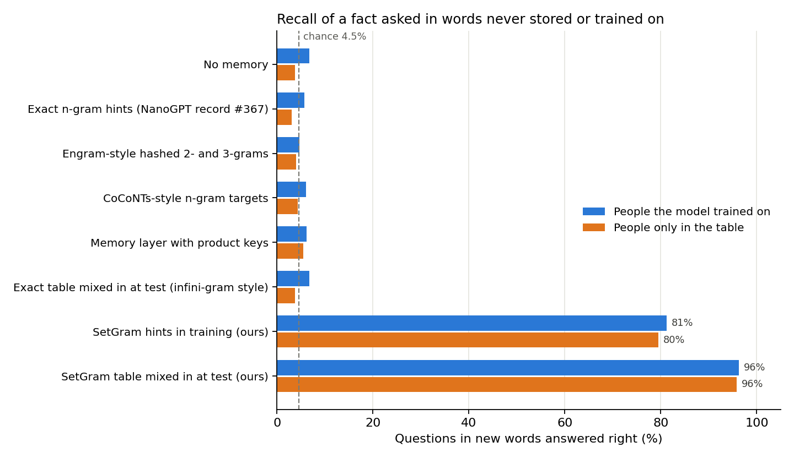
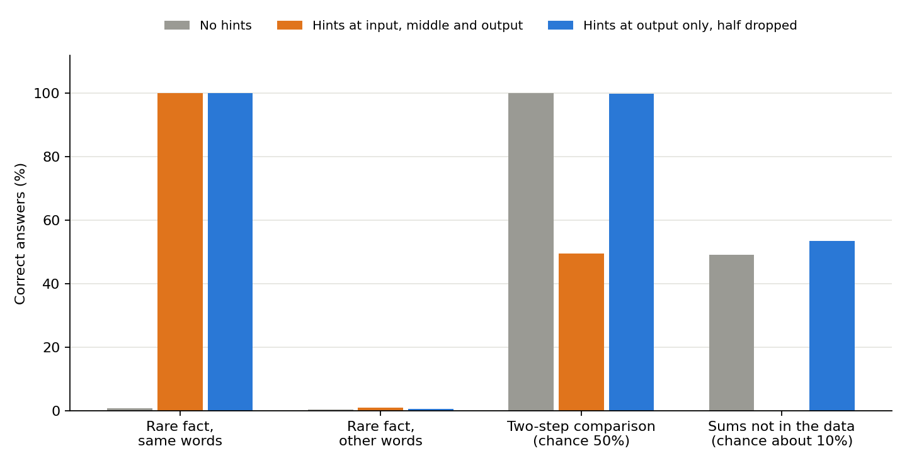

# Key your LLM's n-gram memory by the set of words, not their order, so it recalls facts asked in new words (SetGram)

Code for the paper in [`paper/main.pdf`](paper/main.pdf): **SetGram: an n-gram memory keyed by word sets recalls facts asked in new words**. The paper also surveys how language models use memory today.

## Abstract

**Many language models now carry a memory next to their weights: a big table that is looked up from the last few tokens (a token is a word or a piece of a word). DeepSeek's Engram, the NanoGPT speedrun record's n-gram hints, infini-gram and kNN-LM all work this way.**

**Every one of them looks up the last tokens in their exact order. "N was born in" finds the stored sentence "N was born in Paris". The question "Which city was N born in?" has the same words in a different order, so it finds nothing.**

**SetGram keys the table by the set of the last few rare words instead, in any order. Rare words are names, places and other words outside the 500 most common tokens. Both sentences above then give the same key: {N, born}.**

**On made-up biographies mixed into web text, SetGram answered 80% to 96% of the questions asked in new words. Five published kinds of memory stayed at chance, about 4.5%.**

> [!IMPORTANT]
> Add a table keyed by the set of rare words next to your exact n-gram table. It recalls a fact asked in words the table never stored, even for people the model never trained on. Exact tables, Engram-style hashed n-grams, CoCoNTs-style n-gram targets and a memory layer with product keys all scored at chance on the same questions.

- **Good at facts asked in new words.** People seen in training: 81%. People that appear only in the table: 80%. Mixing the SetGram table into the output at test time: 96% for both.
- **Grows with training and width.** For people only in the table: 50% → 67% → 80% from 30 to 120 steps, and 67% → 79% from 1.2M to 5.0M weights.
- **Not a web-loss method.** On web text it lowered loss little on top of a full exact table (0.003 to 0.010) and cost 0.08 when used alone in training. Use it next to the exact table, not instead.
- **Two tables in training can confuse each other.** Exact + SetGram hints in training recalled only 48% for trained people, because short exact keys fire on the reworded question with another person's answer. Mixed in at test time, the SetGram table cut web loss from 7.807 to 7.670 and recalled 96%.

---

## Look up the set of rare words, so the order of the question does not matter

An n-gram table counts, for each run of the last n tokens in a big text, which token came next. A model can read the most common next token as a hint.

SetGram changes only the key. At each position it takes the last n rare words within the 16 tokens before, sorts them, and hashes the sorted list. A flag says whether the token just before is itself a rare word. The value is still the most common next token, with its count.

Everything else is copied from the NanoGPT record: the hint is added at the input, the middle and the output, its weight is learned per count and share bucket, and a training token's own count is left out of its hint.

> **"N was born in Paris" and "Which city was N born in?" share the key {N, born}, so the stored answer comes back for the new question.**

## SetGram against published memory methods

Biographies of 400 made-up people (birth city, university, company) are mixed into FineWeb text. Half the people appear in training text; the other half are stored only in the table. The test question uses a wording that was never stored or trained on. Width 32, 2 layers, 120 steps, Muon.

| Memory | Web loss | Trained people | People only in the table |
|---|---|---|---|
| None | 7.807 | 6.7% | 3.8% |
| Exact n-gram hints (record #367) | 7.428 | 5.7% | 3.0% |
| Engram-style hashed 2- and 3-grams | 7.808 | 4.7% | 4.0% |
| CoCoNTs-style n-gram targets | 7.761 | 6.0% | 4.3% |
| Memory layer with product keys | 7.806 | 6.2% | 5.5% |
| Exact table mixed in at test (infini-gram style) | 7.348 | 6.7% | 3.8% |
| **SetGram hints in training** | 7.886 | **81.2%** | **79.5%** |
| **SetGram table mixed in at test** | 7.670 | **96.3%** | **95.8%** |

The baselines are simplified re-implementations in [`bio_run.py`](bio_run.py), not the original code. All commands are in [RESULTS.md](RESULTS.md#setgram-made-up-biographies-in-web-text-bio_rowspy-bio_runpy).

> [!WARNING]
> These are small models trained for 120 steps on one made-up fact set, one run per setting. The question wordings are templates, so real rewording (synonyms, other languages) is untested. Width was checked over 4×, not 8×, and steps over 4×.

---

## Earlier results: n-gram hints leak answers and block reasoning

The rest of this repo is the earlier part of the paper, about the exact n-gram hints of the NanoGPT record.

**An n-gram hint tells a language model which token (a word or a piece of a word) most often followed the last few tokens in a large text corpus. For example, after "the capital of France is" the hint is "Paris".**

**Hints cut the NanoGPT Speedrun record from 39.9 s to 6.7 s. That record measures the time to reach a fixed loss, not a lower final loss.**

**Hints can hurt in two ways. If a token's own text is in the counts, the hint is the answer during training but not at test time. And if the model leans on hints, it may never learn the task itself.**

> [!NOTE]
> Leave each token's whole page out of its training hints. If the model must also learn on its own, the simplest candidate is a small hint table in training and the full table at test time: in a small test it kept reasoning and improved facts, but it is untested on web text. On web text, training every step with and without hints plus a switch trained to predict whether each hint is right restored comparison and lowered web loss below plain hints at the longest run.

- **Hints recall a fact stored in the same words.** They scored 100% in the first made-up language test and .81 to .89 in the smaller one. The same fact in other words gets no help.
- **Hints at the model's input blocked reasoning** in a made-up language: two-step comparison fell from 100% to chance.
- **Hints at the output only kept the recall and restored comparison.** With half dropped, sums came back too.
- **Output-only hints cost part of the gain on web text.** They kept 41% and 64% of it at the two sizes tested; with half dropped they kept 7% to 33%.
- **A wider model needs fewer statements of a fact.** It reached 50% at about 45, 10, 4 and 2 statements at widths 16, 32, 64 and 192. More layers did not change this.
- **A model that always gets right hints memorizes almost nothing itself**, even a fact stated 256 times.
- **Training every step with and without hints fixes most of this.** In a joint test it kept 96% of the web gain and restored reasoning with hints off, for 47% more clock time. Reasoning with hints on stayed blocked, and common facts did not come back.
- **Training with hints from the start blocks the skill more than adding hints late.** A model that had already learned comparison changed by +2 to -19 points when hints came on at full strength. More training with hints then removed the skill at width 32 and at 4 layers, and left it about the same at widths 64 and 128.
- **Train with a small table and test with the full one.** With 5% to 60% of the table in training (0.25 to 3 times the lines trained on), comparison stayed at 97% or above at three widths and facts rose from 81% to about 88%, with no switch and no second pass. From 70% to 95% results jumped around, and with the largest table comparison was back at chance. 
- **With test counts scaled, the limit is copies of the training sentences in the table, not table size.** Up to 5 copies comparison stayed at .94 or above across 14 to 40 names, and at 15 or more copies most runs stayed near .50. 60 copies of sentences the model does not train on did no harm. A blocked model just says the first name in the line, and it does well on a new sentence only after that sentence enters the table 30 times, so it never learned to compare. We do not know the full mechanism.
- **Teach a switch to predict whether each hint is right.** Learned from the loss alone it stayed fully on. Taught, at widths 32, 64 and 96 it raised comparison from chance to 90.5%, 100% and 100%, and beat plain hints on web loss by 0.04, 0.07 and 0.09 at 5760 steps. It was behind at 360 steps and level at 1440. Sums with hints on stayed blocked.
- **Hints help text the model itself has not seen.** On web text the gain per token fell to zero once the model had seen the context 64 times.
- **On web text most of the gain comes from short matches of 2 and 3 tokens**, and that gain shrinks as training gets longer.

---

## Remove the token's whole page from its training hints

During training, the text being predicted is also in the corpus. If its own count stays in, the hint is the answer, and the model trusts hints too much. Removing that one count fixes this on Shakespeare. On web text pages repeat themselves, so removing every match from the same page works better.

## Add hints at the output, and drop half, if the model must reason

Hints added at the input let the model skip the task. Adding hints only at the output keeps the model's own layers working. Dropping half then teaches it that a hint can be wrong.

---

## Train with a small hint table if the model must reason

The hint table can solve training lines, so the model may never need to learn the skill. Train with 5% to 60% of the table, then give it the full table at test time. Facts stay in the table, so the model still learns to trust hints. What matters is how many copies of each training sentence the table holds, so keep that to 5 or fewer, or build the table from different text. The record already trains with a small corpus; this test adds that the choice can protect reasoning.

---

## Teach a switch to shut hints that are wrong

Multiply each hint by a switch between 0 and 1, read from the hidden state of a pass without hints. Give the switch its own target: does the hint equal the next token? The data already holds that answer, so this adds one small loss, on top of training every step with and without hints.

---

## Add hints to a finished model only for text that repeats word for word

We left a finished model, MiniCPM5-2B with 2.5 billion parameters, unchanged and only raised the output score of each hinted token. On unseen Wikipedia text the next word went from 41.7% to 43.1% right, so a finished model gains little on general text. New facts came back only in their stored words: 1 to 6 of 11 right, and 1 to 1 reworded. Comparison answers did not change.

| Text, table and test from different files | Hints off | Hints on | Places with a 6-token hint |
|---|---|---|---|
| transformers code, unseen model folders | 66.2% | **83.9%** | 81% |
| Five other Python libraries | 61% to 67% | 63% to 69% | 24% to 38% |
| Own notes | 32.1% | **43.1%** | 20% |
| Wikipedia | 41.7% | 43.1% | 10% |
| Table from another library | 58.6% | 58.4% | 4% |

> **Count how often exact 6-token phrases repeat as a cheap first filter, then measure loss with and without the table at your real context length. Leave off any table that raises the loss.**

The table used 128 tokens of context. At 512 tokens the gain fell from 3.5 to 0.8 points on sympy and from 17.7 to 8.6 on the transformers folders, so only heavily copied code keeps a clear gain.

Details are in [RESULTS.md](RESULTS.md) and `finished/`. The model and text are not in this repo.

## Where it stops working

> [!WARNING]
> The reasoning tasks are a made-up language run on small models, so they show a mechanism and not its size in real models. The small table ran only on the made-up language, and results between 70% and 95% of the table were erratic. The switch ran once at three widths spanning 3.2 times the parameters, and it needs a pass without hints at every step. Engram reports reasoning gains with learned tables, which are a different method.

## Is this new?

We found no memory for language models keyed by an unordered set of words from a stored corpus. Engram, Memory Grafting, TF-Engram, infini-gram, kNN-LM and the NanoGPT record all key by the exact last tokens. NGM (arXiv 2605.16893) averages the last tokens' embeddings, which ignores order, but stores no corpus or next tokens. Trigger language models (Rosenfeld, 1996) let any earlier word predict the next word, but count single word pairs, not sets.

| Work | Lookup | Own text removed | Tested by task kind |
|---|---|---|---|
| [NanoGPT Speedrun record](https://brunborg.com/n-gram-hinted-lm) | next token | earlier steps only | no |
| [Engram](https://arxiv.org/abs/2601.07372) | learned table | not needed | yes, benchmarks |
| [RETRO](https://arxiv.org/abs/2112.04426) | text chunks | same document | no |
| [infini-gram](https://arxiv.org/abs/2401.17377), [kNN-LM](https://arxiv.org/abs/1911.00172) | next token, exact suffix | no | no |
| This repo | next token | own token or page | **yes, known answer kinds** |
| **SetGram (this repo)** | **next token, set of rare words in any order** | own token | **yes, reworded facts** |

We found no gate trained during pretraining on whether the retrieved token is right. Engram has a learned gate with no separate target that we could find, and [kNN-Adapter](https://arxiv.org/abs/2302.10879) learns a per-token mix on top of a frozen model.

## Setup

Small transformers trained with Muon, each setting run once. All numbers and commands are in [RESULTS.md](RESULTS.md). The chart comes from `chart.py`.

## Contribute

Read the [paper](paper/main.pdf) and its source in [`paper/main.tex`](paper/main.tex). The Open Questions section lists what to test next. The first thing to test is whether a small table in training keeps reasoning and the web gain together, in one model on web text and reasoning tasks; `gate.py --small 0.1` is the small test, and `mixed.py` trains the joint model.

Open an issue with your idea or a pull request with your code, command and numbers. Runs on larger models are the most useful.
